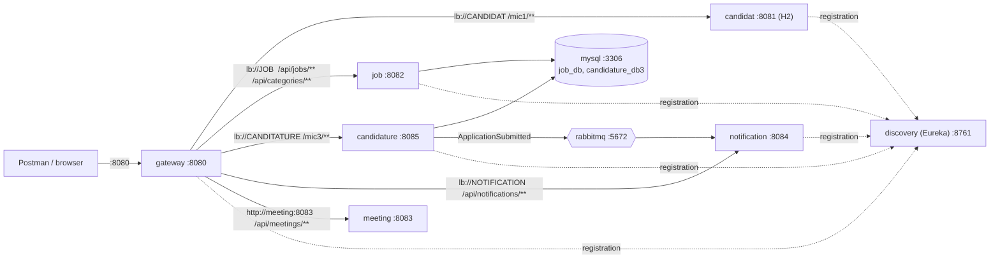

# Chapter 7 – Dockerizing the JobBoard with Docker Compose

🎓 **Module: Distributed Web Applications (AWD)** · 📅 **2026–2027**

One command starts the whole application: infrastructure (MySQL, RabbitMQ), Spring Cloud (Eureka, Gateway)
and the five microservices (candidat, job, candidature, notification, meeting).

```bash
cd backend
docker compose up -d --build
docker compose ps
```

## Architecture



All containers share the `jobboard_default` network created by Compose: **the service name is the address**
(`mysql`, `rabbitmq`, `discovery`, `meeting`…). `localhost` means the container itself.

## Added files

| File | Role |
|---|---|
| `backend/docker-compose.yml` | the 9 services, the network, 2 volumes (`mysql-data`, `rabbitmq-data`), the healthchecks |
| `backend/.env.example` | default passwords (copy to `.env` to change them) |
| `*/Dockerfile` (Java) | 2-stage build: `maven:3.9-eclipse-temurin-17` then `eclipse-temurin:17-jre` |
| `notification-service/Dockerfile` | `python:3.12-slim` + `uvicorn --host 0.0.0.0` |
| `meeting/Dockerfile` | `node:22-alpine` + `npm ci --omit=dev` (student task solution) |
| `*/.dockerignore` | excludes `target/`, `venv/`, `node_modules/`, `.idea/`… |

## Code changes (still compatible with running on your machine)

Each address becomes an **environment variable with a default value**: without Docker, nothing changes.

| Service | Property | On your machine | In Docker |
|---|---|---|---|
| all (Spring) | `eureka.client.service-url.defaultZone=${EUREKA_URL:…}` | `http://localhost:8761/eureka/` | `http://discovery:8761/eureka/` |
| job, candidature | `spring.datasource.url=jdbc:mysql://${DB_HOST:localhost}:${DB_PORT:3306}/…` | `localhost` | `mysql` |
| candidature | `spring.rabbitmq.host=${RABBITMQ_HOST:localhost}` | `localhost` | `rabbitmq` |
| candidature | `eureka.instance.prefer-ip-address=true` (added) | – | register the container IP |
| notification | `EUREKA_INSTANCE_HOST` (new, `app/config.py`) | `localhost` | `notification` |
| gateway | `meeting.url=${MEETING_URL:http://localhost:8083}` | `localhost:8083` | `http://meeting:8083` |

**Gateway**: the `job` route pointed to `/mic2/**`, but job exposes `/api/jobs` and `/api/categories`.
It is fixed, and the `/api/notifications/**` (through Eureka) and `/api/meetings/**` (fixed address) routes are added.

## Test (everything goes through the gateway, port 8080)

```bash
# 1. create a candidate (candidat uses in-memory H2: it starts empty on every restart)
curl -X POST http://localhost:8080/mic1/candidates -H "Content-Type: application/json" \
     -d '{"firstname":"Lina","lastname":"Mansour","email":"lina@example.com"}'
# 2. list the jobs (created by job_db.sql on MySQL's first start)
curl http://localhost:8080/api/jobs
# 3. apply -> candidature calls candidat and job (OpenFeign) then publishes to RabbitMQ
curl -X POST http://localhost:8080/mic3/candidature -H "Content-Type: application/json" \
     -d '{"candidateId":1,"jobId":1,"motivation":"I want to join a Spring Cloud team."}'
# 4. check the confirmation email
curl http://localhost:8080/api/notifications
# 5. meeting
curl http://localhost:8080/api/meetings/hello
```

Wait ≈ 1 minute after `up`: services register with Eureka, then the gateway refreshes its list (30 s).
A **503** error during that time is normal.

## Common problems

| Symptom | Cause | Fix |
|---|---|---|
| `dockerDesktopLinuxEngine … cannot find the file` | Docker Desktop not running | start Docker Desktop (Engine running) |
| `port is already allocated` (8761, 8081…) | a service still runs in IntelliJ / VS Code | stop the local runs |
| `port is already allocated` (5672, 15672) | chapter 6 RabbitMQ container | `docker rm -f awd-rabbitmq` |
| job : `Table 'job_db.job' doesn't exist` | MySQL volume created before `job_db.sql` was mounted | `docker compose down -v` then `up -d` |
| 503 through the gateway | service not registered with Eureka yet | wait 30–60 s, check http://localhost:8761 |
| Changed code is ignored | old image | `docker compose up -d --build <service>` |

## Useful commands

```bash
docker compose logs -f gateway          # a service's logs
docker compose exec mysql mysql -uroot -proot -e "SHOW DATABASES;"
docker compose up -d --build candidature  # rebuild a single service
docker compose down -v                  # remove everything, volumes included
docker images "jobboard/*"              # built images
```
