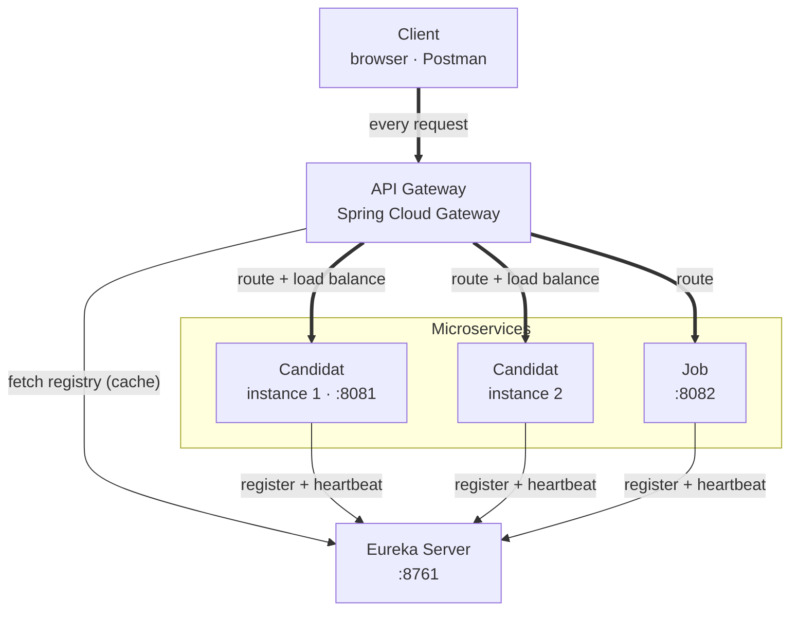

# Chapter 5 — API Gateway

**Distributed Web Architecture (AWD)** · ESPRIT School of Engineering · 4th-year Computer Engineering · 2026–2027

---

## Why this chapter?

In Chapter 4, every JobBoard service registered with **Eureka**, and the services started finding each other **by name**, never by IP.
The client side, however, still has the old problem: a web or mobile front end must know the address of Candidat, of Job,
and of every instance of each, and must change whenever one of them moves or scales out.

This chapter adds a **single entry point**. Clients send every request to the **API Gateway**, which selects an available instance
of the right microservice and forwards the request to it. Clients no longer need to know where the services live, or how many instances exist.

---

## Learning outcomes

By the end of this chapter, students will be able to:

1. **Explain** the role of an API Gateway in a microservices architecture.
2. **Describe** how the gateway receives a request, selects an instance and forwards the request.
3. **Configure** static routes, where each route points to a fixed URL.
4. **Configure** dynamic routes resolved through **Eureka** (`lb://SERVICE-NAME`).
5. **Observe** load balancing between several instances of the same service, using the routing logs.
6. **Change** the load-balancing algorithm for a single service.
7. **Compare** the static and dynamic approaches and justify the choice of each.

---

## What this chapter covers

| # | Section | Key ideas |
| --- | --- | --- |
| 1 | Why? | One entry point instead of one address per service and per instance |
| 2 | The gateway | Routes, request forwarding, the gateway as a smart intermediary |
| 3 | Static configuration | `uri: http://host:port` · one route = one fixed address |
| 4 | Dynamic configuration | `uri: lb://SERVICE-NAME` · names resolved through Eureka |
| 5 | Load balancing | Several instances, routing logs, default algorithm, **Random** for Candidat only |
| 6 | Comparison | Static vs dynamic: strengths, limits, when to use each |

---

## JobBoard behind the gateway: the architecture

| Service | Technology | Port | Name in Eureka | Role in this chapter |
| --- | --- | --- | --- | --- |
| **Eureka Server** | Spring Boot (Spring Cloud Netflix) | 8761 | — | Registry of the services |
| **API Gateway** | Spring Cloud Gateway · Eureka client | — | — | Single entry point, routing and load balancing |
| **Candidat** | Spring Boot · H2 | 8081 (+ other instances) | `CANDIDAT` | Target service, several instances |
| **Job** | Spring Boot · MySQL | 8082 | `JOB` | Target service |

> **Rule of thumb:** Eureka is still a **registry, not a proxy**. The **gateway** is the proxy: it reads the registry
> from Eureka, then forwards each client request directly to the chosen instance.

---

## The API Gateway in a nutshell

| Step | What happens |
| --- | --- |
| **① Receive** | The client sends its request to the gateway, never directly to a microservice. |
| **② Match a route** | The gateway finds the route that matches the request and reads its target `uri`. |
| **③ Select an instance** | With `lb://SERVICE-NAME`, the gateway picks one available instance from the Eureka registry. With `http://...`, the address is fixed. |
| **④ Forward** | The request is forwarded to the chosen instance, and the response goes back to the client through the gateway. |

---

## Static vs dynamic routing

| Approach | Uses Eureka? | Strengths | Limits |
| --- | --- | --- | --- |
| **Dynamic** (`uri: lb://SERVICE`) | ✅ Yes | No need to know the exact URL, supports several instances, automatic load balancing | Depends on Eureka |
| **Static** (`uri: http://...`) | ❌ No | Simple and quick to configure | Not suited to dynamic environments (moving or scaling instances) |

---

## Workshop — Implementing the API Gateway

| Part | Work | Where |
| --- | --- | --- |
| **1** | Create the gateway and implement a **static configuration** | In class |
| **2** | Implement a **dynamic configuration** with Eureka | In class |
| **3** | Enable the **routing logs** and identify the default **load-balancing algorithm** | In teams |
| **4** | Use the **Random** algorithm for the **Candidat** service only | In teams |
| **5** | Compare the two approaches (static vs dynamic) | In teams |

Technologies: Java 17 · Spring Boot · Spring Cloud Gateway · Spring Cloud Netflix Eureka Client · Maven · IntelliJ IDEA.

The detailed brief is available as a PDF: 👉 [Workshop brief — API Gateway](Implémentation%20API%20Gateway.pdf)

Deliverables per team:

- a working **API Gateway** project;
- correct routing to the microservices;
- a successful integration with **Eureka**;
- load balancing **visible in the console**;
- clean, well-structured code;
- the project pushed to **GitHub**, with the names of the team members.

> **Tip:** always start the **Eureka server first**, then the microservices, then the API Gateway.
> A service may take up to 30 s to appear in the registry and become reachable through the gateway.

---

## Resources in this branch

| Resource | Description |
| --- | --- |
| `eureka-server/` | Spring Boot Eureka server (port 8761) |
| `api-gateway/` | Spring Cloud Gateway project, registered as an Eureka client |
| `candidat-service/` | Candidat microservice registered as an Eureka client |
| `job-service/` | Job microservice registered as an Eureka client |
| `Implémentation API Gateway.pdf` | Workshop brief |

Course slides, workshop brief and the chapter quiz: on the ESPRIT Blackboard space of the module.

---

## Previous and next

- ⬅ [Chapter 4 — Service Discovery and Observability](https://github.com/badi3a/AWD-Training/tree/Chapter_04)
- 🏠 [Module home page (main branch)](https://github.com/badi3a/AWD-Training)
- ➡ Chapter 6 *(coming soon)*

---

## Main references

- C. Richardson, *Microservices Patterns*, Manning, 2018 · microservices.io: *API Gateway*, *Server-side discovery*.
- S. Newman, *Building Microservices*, 2nd ed., O'Reilly, 2021.
- Spring Cloud Gateway reference documentation.
- Spring Cloud Commons reference documentation — *Spring Cloud LoadBalancer*.
- Spring Cloud Netflix reference documentation — *Service Discovery: Eureka Clients*.

---

## Instructor

<table>
  <tr>
    <td width="140" align="center" valign="top">
      
    </td>
    <td valign="top">
      <h3>Dr. Badia Bouhdid</h3>
      

        Lecturer at <b>ESPRIT School of Engineering</b>, in charge of the
        <b>Distributed Web Architecture (AWD)</b> module for 4th-year Computer Engineering students.
      

      

        Teaching focus: software architecture, distributed systems, REST APIs and microservices,
        through problem-based learning and a single running example, <b>JobBoard</b>.
      

      

        
        
        
      

    </td>
  </tr>
</table>

Enjoy the journey into distributed systems.

