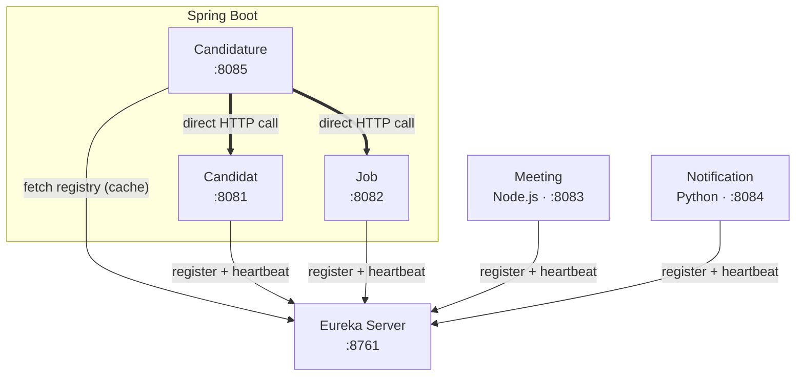

<div align="center">

# Chapter 4 — Service Discovery and Observability

**Distributed Web Architecture (AWD)** · ESPRIT School of Engineering · 4th-year Computer Engineering · 2026–2027

[](https://github.com/badi3a/AWD-Training)
[](#chapter-4--service-discovery-and-observability)
[](#what-this-chapter-covers)
[](#eureka-in-a-nutshell)
[](#observability-with-spring-boot-actuator)

</div>

---

## Why this chapter?

In Chapter 3, JobBoard was decomposed **by business domain** into autonomous services, each with its own database.
On paper, the target architecture is clear. In practice, a first question arises as soon as two services must talk:
Candidature needs Candidat and Job, **but where are they?** In the cloud, an address is never stable: a container is recreated,
an instance is added under load, a crashed service restarts elsewhere.

A second question follows immediately: once a request crosses four or five services, **how do we see what is happening inside each of them?**

This chapter answers both questions. Services **register** with a discovery server and **find each other by name**, never by IP.
Each service **exposes its health**, so that a failing instance is detected and no longer receives traffic.

---

## Learning outcomes

By the end of this chapter, students will be able to:

1. **Explain** the role of a discovery server and the limits of hard-coded IP addresses in the cloud.
2. **Describe** the life cycle of an instance: registration, heartbeat, lease expiry and eviction.
3. **Distinguish** client-side discovery from server-side discovery.
4. **Analyse** the REST exchanges between microservices and the Eureka server.
5. **Interpret** the Eureka dashboard, including self-preservation mode.
6. **Justify** the need for observability: logs, metrics and traces.
7. **Use** Spring Boot Actuator: the `/health`, `/info` and `/metrics` endpoints.
8. **Connect** Actuator to Eureka so that an unhealthy instance is no longer offered to other services.

---

## What this chapter covers

| # | Section | Key ideas |
| --- | --- | --- |
| 1 | Why? | Unstable addresses, scaling, failures, *N × (N − 1)* hard-coded URLs |
| 2 | Architecture | Registry, provider, consumer · client-side vs server-side discovery · Eureka, Consul, ZooKeeper, Kubernetes |
| 3 | Eureka | Server and clients, logical names, the REST API, polyglot clients (Node.js, Python), the dashboard |
| 4 | Life cycle | Register, heartbeat (30 s), lease (90 s), eviction, local cache, failure scenario, self-preservation |
| 5 | Observability | Why it becomes mandatory, the three pillars: logs, metrics, traces |
| 6 | Spring Boot Actuator | Endpoints, `/actuator/health`, custom health indicators, liveness and readiness, link with Eureka |
| 7 | Good practices | Naming, securing Actuator, highly available Eureka, common pitfalls |

---

## JobBoard with Eureka: the architecture



| Service | Technology | Port | Name in Eureka | Eureka client |
| --- | --- | --- | --- | --- |
| **Eureka Server** | Spring Boot (Spring Cloud Netflix) | 8761 | — | `spring-cloud-starter-netflix-eureka-server` |
| **Candidat** | Spring Boot · H2 | 8081 | `CANDIDAT` | `spring-cloud-starter-netflix-eureka-client` |
| **Job** | Spring Boot · MySQL | 8082 | `JOB` | `spring-cloud-starter-netflix-eureka-client` |
| **Meeting** | Node.js / Express | 8083 | `MEETING` | `eureka-js-client` |
| **Notification** | Python / FastAPI | 8084 | `NOTIFICATION` | `py-eureka-client` |

> **Rule of thumb:** Eureka is a **registry, not a proxy**. Services register, send a heartbeat every 30 s and fetch the registry,
> then call each other **directly**. No business request ever goes through Eureka.

---

## Eureka in a nutshell

| Step | What happens |
| --- | --- |
| **① Register** | At start-up, a service sends its logical name, IP, port and status (`UP`) to Eureka. |
| **② Heartbeat** | Every 30 s, the service renews its lease. Without a heartbeat for 90 s, the lease expires and the instance is evicted. |
| **③ Fetch registry** | The consumer downloads the registry once, then only the changes (delta) every 30 s, and keeps it in a **local cache**. |
| **④ Direct call** | Spring Cloud LoadBalancer picks an instance from the cache (round robin by default) and the call goes straight to it. |

Detecting a failure takes **minutes, not seconds** (lease expiry, eviction task, client caches).
The caller must protect itself: short timeouts, retry on another instance, circuit breaker.

When fewer than **85 %** of the expected heartbeats arrive, Eureka enters **self-preservation mode** and stops evicting instances:
it assumes a network partition rather than the death of every service. Keep it enabled in production.

---

## Observability with Spring Boot Actuator

| Pillar | Question it answers | Typical tools |
| --- | --- | --- |
| **Logs** | What happened? | ELK, Loki |
| **Metrics** | How is the system behaving? | Micrometer, Prometheus, Grafana |
| **Traces** | Where did this request go? | Micrometer Tracing, Zipkin, OpenTelemetry |

Minimal Actuator configuration used in the workshop (`application.properties` of the Job service):

```properties
# Expose the health, info and metrics endpoints (only health is exposed by default)
management.endpoints.web.exposure.include=health,info,metrics

# Show the details of each component in /health (db, diskSpace, ping…)
management.endpoint.health.show-details=always

# Publish the /health status to Eureka (Job goes DOWN if its database fails)
eureka.client.healthcheck.enabled=true

# Publish the info.* properties in /actuator/info (disabled by default)
management.info.env.enabled=true

# Content returned by /actuator/info
info.app.name=Job
info.app.version=1.0.0
info.app.description=Job offers microservice
```

> **Try it:** stop MySQL, open `http://localhost:8082/actuator/health` (`db` is `DOWN`), wait about 30 s and reload the Eureka dashboard:
> `JOB` is now `DOWN` and is no longer offered to the other services.

---

## Workshop — Implementing the Eureka server

| Part | Work | Where |
| --- | --- | --- |
| **1** | Create the Eureka server (`@EnableEurekaServer`, port 8761) and open its dashboard | In class |
| **2** | Register **Candidat** and **Job** as Eureka clients, run several instances of Candidat on different ports | In class |
| **3** | Register **Meeting** (Node.js, `eureka-js-client`) and **Notification** (Python, `py-eureka-client`) in the same server | In teams |
| **Bonus** | Add a `/health` endpoint to Meeting and Notification · discover `CANDIDAT` through Eureka instead of a hard-coded URL | In teams |

Deliverables per team:

- a working **Eureka server**;
- **CANDIDAT, JOB, MEETING and NOTIFICATION** visible at the same time in the dashboard;
- **at least two instances** of Meeting or Notification on different ports;
- a **screenshot of the dashboard** in the team README;
- the project pushed to **GitHub**, with the names of the team members.

> **Tip:** start the Eureka server first, then Candidat and Job, then Meeting and Notification.
> A service may take up to 30 s to appear in the dashboard.

---

## Resources in this branch

| Resource | Description |
| --- | --- |
| `eureka-server/` | Spring Boot Eureka server (port 8761) |
| `candidat-service/` | Candidat microservice registered as an Eureka client, with Actuator |
| `job-service/` | Job microservice registered as an Eureka client, with Actuator |
| `meeting-service/` | Meeting microservice (Node.js / Express), starting point for Part 3 |
| `notification-service/` | Notification microservice (Python / FastAPI), starting point for Part 3 |

Course slides, workshop brief, the "Service Discovery" and "Observability" pages and the chapter quiz:
on the ESPRIT Blackboard space of the module.

---

## Previous and next

- ⬅ [Chapter 3 — Migrating to Microservices](https://github.com/badi3a/AWD-Training/tree/Chapter_03)
  · video: [Microservices architecture](https://youtu.be/iTa7LFezcSU)
- 🏠 [Module home page (main branch)](https://github.com/badi3a/AWD-Training)
- ➡ Chapter 5 — API Gateway and centralised configuration *(coming soon)*

---

## Main references

- S. Newman, *Building Microservices*, 2nd ed., O'Reilly, 2021.
- C. Richardson, *Microservices Patterns*, Manning, 2018 · microservices.io: *Service registry*, *Client-side discovery*, *Server-side discovery*.
- C. Sridharan, *Distributed Systems Observability*, O'Reilly, 2018.
- C. Majors, L. Fong-Jones & G. Miranda, *Observability Engineering*, O'Reilly, 2022.
- Spring Cloud Netflix reference documentation — *Service Discovery: Eureka Clients* and *Eureka Server*.
- Spring Boot reference documentation — *Production-ready Features* (Actuator).
- Netflix Eureka wiki — *Eureka REST operations* · *Server Self Preservation Mode*, github.com/Netflix/eureka.

---

## Instructor

<table>
  <tr>
    <td width="140" align="center" valign="top">
      
    </td>
    <td valign="top">
      <h3>Dr. Badia Bouhdid</h3>
      <p>
        Lecturer at <b>ESPRIT School of Engineering</b>, in charge of the
        <b>Distributed Web Architecture (AWD)</b> module for 4th-year Computer Engineering students.
      </p>
      <p>
        Teaching focus: software architecture, distributed systems, REST APIs and microservices,
        through problem-based learning and a single running example, <b>JobBoard</b>.
      </p>
      <p>
        <a href="mailto:badiaa.bouhdid@esprit.tn"></a>
        <a href="https://www.linkedin.com/in/badiabouhdid"></a>
        <a href="https://github.com/badi3a"></a>
      </p>
    </td>
  </tr>
</table>

<div align="center">
<sub>Enjoy the journey into distributed systems.</sub>
</div>